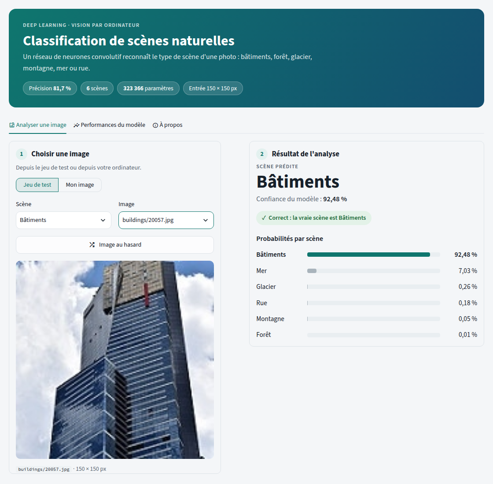
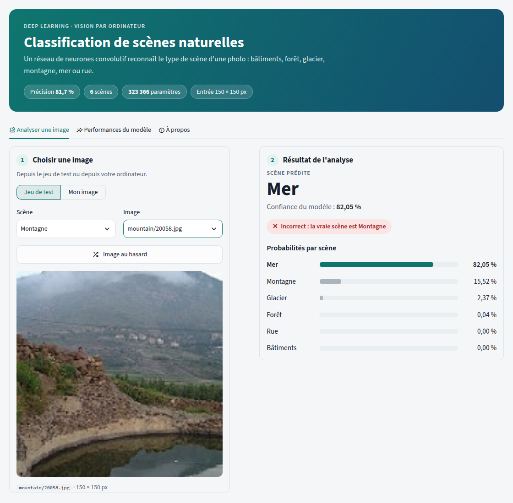
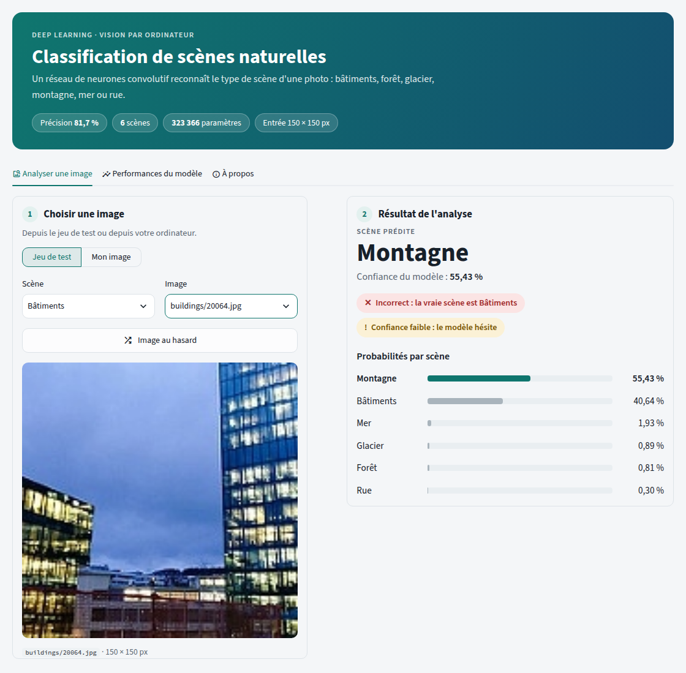
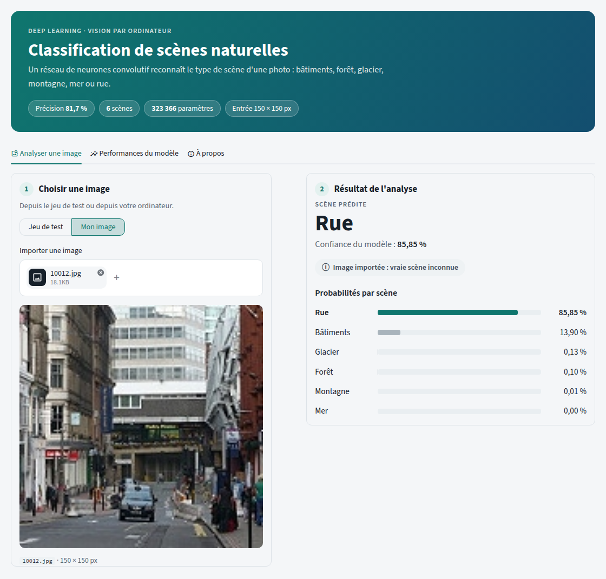
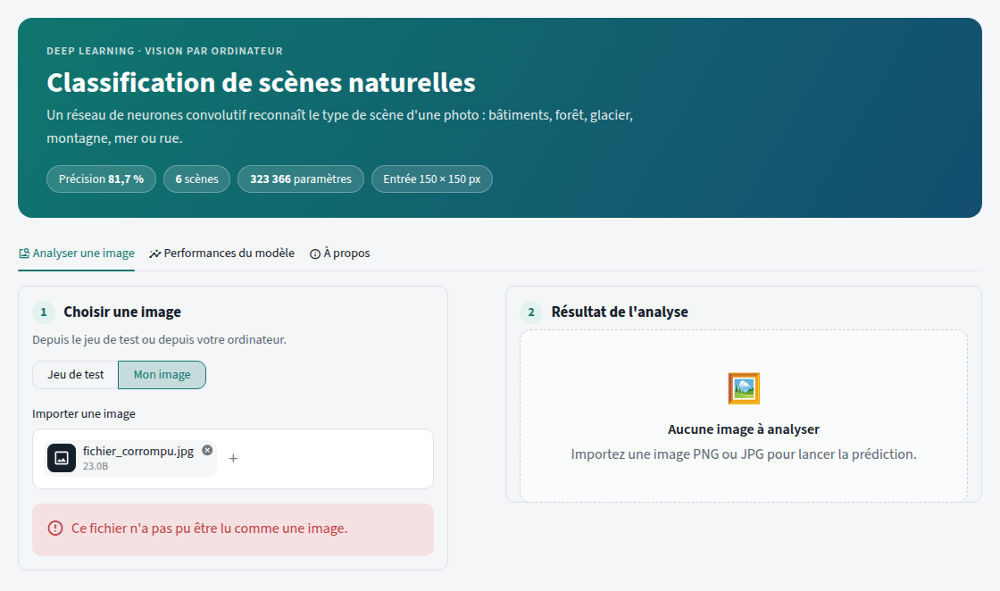
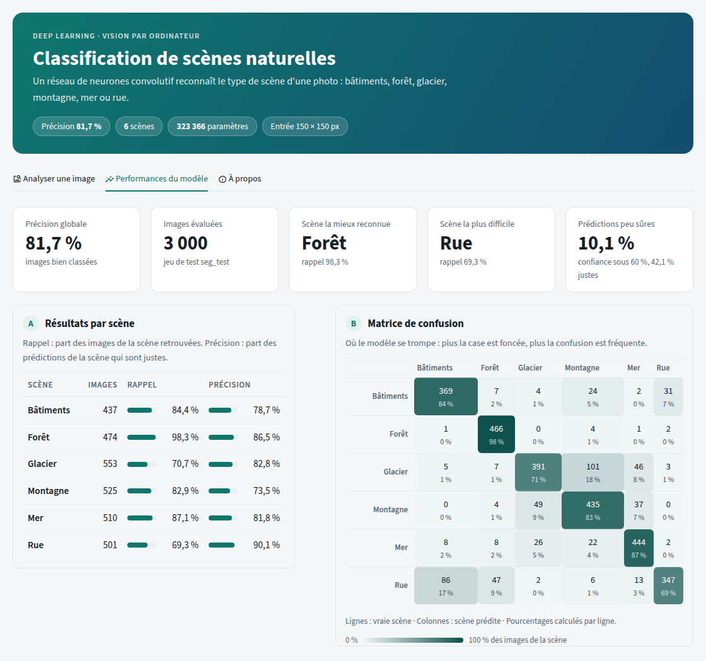
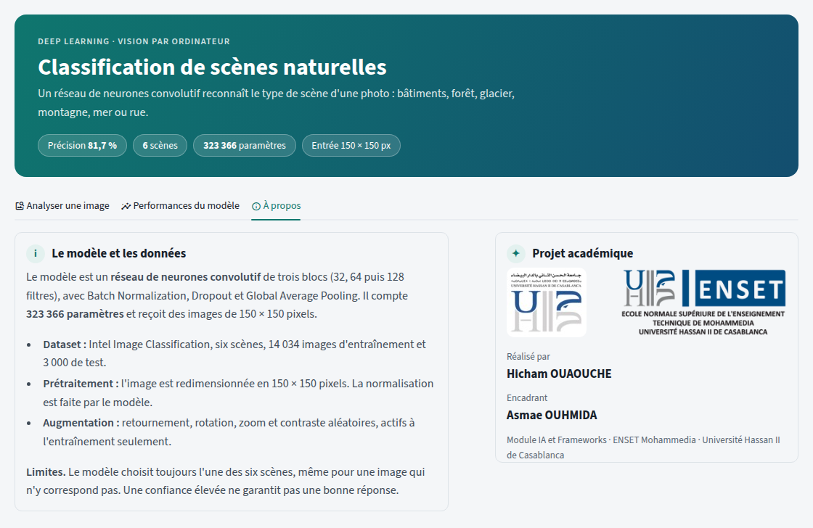
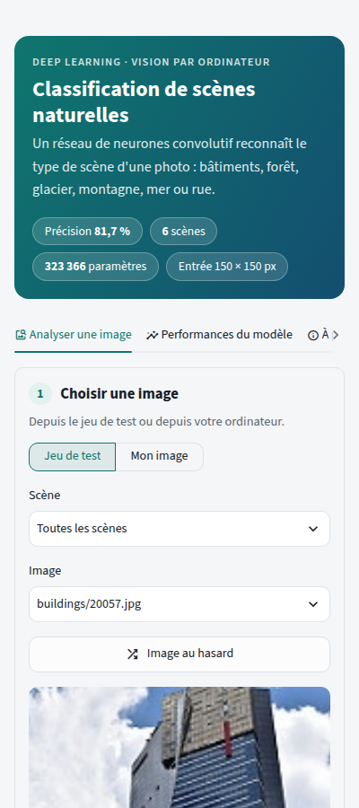

# Classification de scènes naturelles par réseau de neurones convolutif

Application web qui reconnaît le type de scène d'une photographie (bâtiments,
forêt, glacier, montagne, mer ou rue) grâce à un réseau de neurones convolutif
(CNN) entraîné sur le dataset
[Intel Image Classification](https://www.kaggle.com/datasets/puneet6060/intel-image-classification),
et rendue accessible par une interface [Streamlit](https://streamlit.io).

**Démo en ligne : https://backend-spring-bo-gvz7auhrrt4xd7qe5sl5uv.streamlit.app/**

| Précision sur le jeu de test | Scènes reconnues | Paramètres du modèle | Images d'entrée |
|---|---|---|---|
| **81,7 %** | 6 | 323 366 | 150 × 150 px |



## Sommaire

1. [Contexte et objectifs](#1-contexte-et-objectifs)
2. [Le dataset](#2-le-dataset)
3. [Le modèle CNN](#3-le-modèle-cnn)
4. [Architecture du projet](#4-architecture-du-projet)
5. [L'interface](#5-linterface)
6. [Installation et utilisation](#6-installation-et-utilisation)
7. [Déploiement en ligne](#7-déploiement-en-ligne)
8. [Tests](#8-tests)
9. [Résultats](#9-résultats)
10. [Limites et perspectives](#10-limites-et-perspectives)
11. [Technologies](#11-technologies)
12. [Auteur et encadrement](#12-auteur-et-encadrement)

---

## 1. Contexte et objectifs

Reconnaître automatiquement le contenu d'une image est l'un des usages les plus
répandus de l'apprentissage profond. Ce projet traite un cas concret : identifier
le type de scène représenté sur une photo, parmi six catégories.

Une même photo peut contenir plusieurs éléments, comme une rue bordée de façades
ou une montagne au bord d'un lac. Le modèle doit donc extraire des
caractéristiques visuelles (textures, formes, couleurs) et les associer à la
bonne catégorie.

Le projet poursuit quatre objectifs :

1. **Exploiter un modèle CNN** entraîné sur le dataset Intel pour classer une image parmi six scènes.
2. **Rendre le modèle utilisable** par une personne non technique, au moyen d'une interface web.
3. **Mesurer objectivement** ses performances sur des images qu'il n'a pas vues à l'entraînement.
4. **Organiser le code comme un projet professionnel** : modules séparés, tests automatiques, documentation et déploiement en ligne.

## 2. Le dataset

Le dataset Intel Image Classification regroupe des photos de scènes naturelles et
urbaines en couleur. Les images mesurent presque toutes 150 × 150 pixels : sur les
3 000 images de test, seules 7 ont une hauteur différente.

Il est livré en trois parties :

| Partie | Images | Étiquetées | Usage |
|---|---|---|---|
| `seg_train` | 14 034 | Oui | Entraînement du modèle |
| `seg_test` | 3 000 | Oui | Évaluation du modèle |
| `seg_pred` | 7 301 | Non | Essais libres, comme un utilisateur |

Les six scènes sont représentées de façon équilibrée : chacune compte entre 15 %
et 18 % des images. Le modèle ne favorise donc pas une scène simplement parce
qu'elle serait plus fréquente.

| Scène | Entraînement | Test |
|---|---|---|
| Bâtiments | 2 191 | 437 |
| Forêt | 2 271 | 474 |
| Glacier | 2 404 | 553 |
| Montagne | 2 512 | 525 |
| Mer | 2 274 | 510 |
| Rue | 2 382 | 501 |
| **Total** | **14 034** | **3 000** |

Le dataset complet (environ 400 Mo) n'est pas versionné. Le dossier `samples/`
contient un échantillon de 60 images du jeu de test, 10 par scène, pour que
l'application fonctionne sans téléchargement.

## 3. Le modèle CNN

### Architecture

Le modèle, nommé `CNN_improved`, est un réseau convolutif séquentiel de trois
blocs de profondeur croissante, suivis d'une tête de classification. Il compte
**323 366 paramètres** (322 470 entraînables) pour une taille de 3,9 Mo.

| Étape | Couches | Sortie |
|---|---|---|
| Entrée | Image RGB | 150 × 150 × 3 |
| Augmentation | Retournement, rotation, zoom, contraste (entraînement seulement) | 150 × 150 × 3 |
| Normalisation | `Rescaling` : pixels divisés par 255 | 150 × 150 × 3 |
| Bloc 1 | 2 × (Conv2D 32, BatchNorm, ReLU), MaxPooling, Dropout 0,25 | 75 × 75 × 32 |
| Bloc 2 | 2 × (Conv2D 64, BatchNorm, ReLU), MaxPooling, Dropout 0,25 | 37 × 37 × 64 |
| Bloc 3 | 2 × (Conv2D 128, BatchNorm, ReLU), MaxPooling, Dropout 0,25 | 18 × 18 × 128 |
| Classification | GlobalAveragePooling, Dense 256 ReLU, Dropout 0,5, Dense 6 Softmax | 6 probabilités |

Choix de conception :

- **Normalisation intégrée** : la couche `Rescaling` fait partie du modèle. L'application lui transmet les pixels bruts (0 à 255), sans risque d'appliquer une normalisation différente de celle de l'entraînement.
- **Batch Normalization** : elle stabilise et accélère l'apprentissage en normalisant les activations après chaque convolution.
- **Global Average Pooling** : il remplace l'aplatissement classique et réduit fortement le nombre de paramètres de la tête de classification, ce qui limite le surapprentissage.
- **Dropout** : des neurones sont désactivés au hasard pendant l'entraînement (25 % dans les blocs, 50 % avant la sortie) pour améliorer la généralisation.

### Augmentation des données

Pour enrichir le jeu d'entraînement, chaque image subit des transformations
aléatoires avant d'entrer dans le réseau. Ces couches sont automatiquement
désactivées lors de la prédiction.

| Transformation | Paramètre |
|---|---|
| Retournement | Horizontal |
| Rotation | Jusqu'à ± 10 % d'un tour complet |
| Zoom | Jusqu'à ± 10 % en hauteur |
| Contraste | Variation jusqu'à 10 % |

### Configuration d'entraînement

Le script d'entraînement ne fait pas partie de ce dépôt. Les informations
suivantes sont celles enregistrées dans le fichier du modèle.

| Paramètre | Valeur |
|---|---|
| Optimiseur | Adam |
| Fonction de perte | Entropie croisée catégorielle (`sparse_categorical_crossentropy`) |
| Métrique suivie | Précision (`accuracy`) |
| Taux d'apprentissage final | 3,125 × 10⁻⁵ |
| Sauvegarde | Meilleur modèle conservé (`cnn_intel_best.keras`) |

Le taux d'apprentissage final vaut exactement 10⁻³ divisé par 32, ce qui laisse
penser qu'il a été réduit de moitié cinq fois pendant l'entraînement, par exemple
par un mécanisme de type `ReduceLROnPlateau`.

## 4. Architecture du projet

### Structure des dossiers

```
.
├── app.py                    # Interface Streamlit (point d'entrée)
├── scene_classifier/         # Code métier, indépendant de l'interface
│   ├── config.py             # Chemins, classes, seuils et informations du projet
│   ├── model.py              # Chargement du modèle et prédiction
│   ├── dataset.py            # Accès aux images
│   ├── evaluation.py         # Calcul et lecture des métriques
│   └── ui.py                 # Styles et composants visuels de l'interface
├── scripts/
│   └── evaluate.py           # Évalue le modèle et écrit models/metrics.json
├── tests/                    # Tests automatiques (pytest)
├── models/
│   ├── cnn_intel_best.keras/ # Modèle entraîné (architecture et poids)
│   └── metrics.json          # Métriques sur le jeu de test
├── samples/                  # Échantillon de 60 images du jeu de test
├── assets/                   # Logos de l'ENSET et de l'UH2C
├── docs/screenshots/         # Captures d'écran
├── .streamlit/config.toml    # Thème de l'interface
├── requirements.txt          # Dépendances de l'application
└── requirements-dev.txt      # Dépendances de développement (tests)
```

### Rôle des modules

Le paquet `scene_classifier` contient toute la logique et ne dépend pas de
Streamlit. Il est ainsi réutilisé par l'application, le script d'évaluation et
les tests.

| Module | Responsabilité |
|---|---|
| `config.py` | Centralise les chemins, les six classes dans l'ordre du modèle, leurs libellés français et le seuil de confiance faible (60 %). |
| `model.py` | Reconstruit le modèle, vérifie qu'il a six sorties, prétraite les images et renvoie les probabilités. |
| `dataset.py` | Liste les images disponibles et déduit la vraie scène du nom du dossier. |
| `evaluation.py` | Calcule la précision, le rappel, la matrice de confusion et les statistiques de confiance. |
| `ui.py` | Fournit les styles et les composants : bandeau, pastilles de statut, barres de probabilités, indicateurs, tableau et matrice. |
| `app.py` | Assemble les trois onglets et gère les interactions de l'utilisateur. |

### Déroulement d'une prédiction

1. **Chargement** : le modèle est chargé une seule fois au démarrage, puis gardé en mémoire par le cache de Streamlit.
2. **Lecture** : l'image choisie ou importée est ouverte avec Pillow et convertie en RGB.
3. **Prétraitement** : elle est redimensionnée en 150 × 150 pixels par interpolation bilinéaire, puis convertie en tableau NumPy.
4. **Inférence** : le modèle renvoie six probabilités dont la somme vaut 1.
5. **Affichage** : la scène la plus probable est mise en avant, avec les probabilités triées.

### Choix techniques

- **Chargement du modèle** : `cnn_intel_best.keras` est un dossier décompressé, que `keras.models.load_model` refuse. Le modèle est donc reconstruit depuis son architecture (`config.json`), puis ses poids sont chargés (`model.weights.h5`).
- **Prétraitement unique** : l'application, le script d'évaluation et les tests utilisent la même fonction. Les performances mesurées correspondent donc exactement à ce que voit l'utilisateur.
- **Métriques non figées** : la précision affichée est lue dans `models/metrics.json`, produit par le script d'évaluation, et non écrite en dur dans le code.
- **Images disponibles** : l'application utilise le jeu de test complet de `data/` s'il est présent, sinon l'échantillon de `samples/`.

## 5. L'interface

L'interface est un tableau de bord en trois onglets, précédé d'un bandeau qui
résume le modèle. Elle suit quelques principes :

- **Une tâche par onglet** : analyser une image, comprendre les performances, découvrir le projet.
- **Un parcours guidé** : les cartes sont numérotées (1. Choisir une image, 2. Résultat de l'analyse).
- **Une couleur, un sens** : le vert sarcelle désigne la scène prédite. Le vert, le rouge et le jaune sont réservés aux statuts Correct, Incorrect et Confiance faible, toujours accompagnés d'une icône et d'un texte.

### Onglet « Analyser une image »

L'utilisateur choisit une image du jeu de test, filtrée par scène ou tirée au
hasard, ou importe sa propre image (PNG ou JPG). Le résultat affiche :

- la **scène prédite** et la **confiance** du modèle ;
- des **pastilles de statut** : Correct ou Incorrect quand la vraie scène est connue, Image importée sinon, et Confiance faible sous 60 % ;
- les **probabilités des six scènes**, triées, avec la scène prédite en couleur.

| Prédiction incorrecte | Confiance faible |
|---|---|
|  |  |

| Image importée | Fichier invalide |
|---|---|
|  |  |

Un fichier illisible produit un message d'erreur clair, sans interrompre
l'application.

### Onglet « Performances du modèle »

Il présente cinq indicateurs clés, le rappel et la précision de chaque scène,
puis la matrice de confusion en carte de chaleur : plus une case est foncée, plus
la confusion est fréquente. Les valeurs restent écrites dans chaque case.



### Onglet « À propos »

Il décrit le modèle, les données et les limites du système, ainsi que le cadre
académique du projet.



### Affichage mobile

Sur un écran étroit, les cartes s'empilent et aucun élément ne déborde.



## 6. Installation et utilisation

### Prérequis

- Python 3.14 (versions de `requirements.txt`)
- Environ 1 Go de mémoire libre pour TensorFlow

### Installation

```bash
git clone https://github.com/hichamouaouche/intel-scene-classifier.git
cd intel-scene-classifier
python3 -m venv .venv
source .venv/bin/activate
pip install -r requirements-dev.txt
```

L'application fonctionne directement avec l'échantillon de `samples/` et les
métriques de `models/metrics.json`.

Pour utiliser les 3 000 images du jeu de test ou recalculer les métriques,
téléchargez le dataset depuis
[Kaggle](https://www.kaggle.com/datasets/puneet6060/intel-image-classification)
et placez-le dans `data/`, avec un dossier par scène :
`data/seg_test/seg_test/<scène>/<image>.jpg`. L'application l'utilise alors
automatiquement.

### Commandes

Toutes les commandes se lancent depuis la racine du projet.

| Action | Commande |
|---|---|
| Lancer l'application | `streamlit run app.py` |
| Recalculer les métriques | `python -m scripts.evaluate` |
| Lancer les tests | `python -m pytest` |

L'application s'ouvre sur <http://localhost:8501>. Pour l'arrêter, appuyez sur
`Ctrl + C` dans le terminal.

## 7. Déploiement en ligne

L'application est déployée gratuitement sur
[Streamlit Community Cloud](https://share.streamlit.io) :

**https://backend-spring-bo-gvz7auhrrt4xd7qe5sl5uv.streamlit.app/**

Étapes suivies :

1. Connexion à Streamlit Community Cloud avec le compte GitHub.
2. Création de l'application à partir du dépôt `intel-scene-classifier`, branche `main`, fichier `app.py`.
3. Installation automatique des dépendances de `requirements.txt`.

Chaque nouveau commit sur `main` redéploie automatiquement l'application. Comme
le dataset complet n'est pas versionné, la version en ligne propose l'échantillon
de 60 images de `samples/`. Les métriques de `models/metrics.json` sont celles
calculées sur les 3 000 images du jeu de test.

Une application gratuite se met en veille après une période sans visite : il
suffit alors de cliquer sur le bouton de réveil et d'attendre quelques instants.

## 8. Tests

### Tests automatiques

Onze tests, écrits avec pytest, vérifient le modèle et l'interface. Ils se
lancent avec `python -m pytest`.

| Test | Vérification |
|---|---|
| `test_model_matches_classes` | Entrée 150 × 150 × 3 et six sorties |
| `test_preprocess_keeps_pixel_range` | Redimensionnement et pixels laissés entre 0 et 255 |
| `test_probabilities_sum_to_one` | Somme des probabilités égale à 1 |
| `test_known_image_is_classified` | Une image connue est bien classée |
| `test_dataset_has_every_class` | Les six scènes sont présentes dans le jeu de test |
| `test_samples_cover_every_class` | L'échantillon couvre les six scènes |
| `test_compute_metrics` | Calcul des métriques sur un exemple connu |
| `test_first_image_is_predicted` | L'application démarre et affiche une prédiction |
| `test_class_filter` | Le filtre par scène met à jour la liste |
| `test_random_button` | Le bouton « Image au hasard » fonctionne |
| `test_performance_tab` | L'onglet Performances affiche les indicateurs et la matrice |

Le test `test_dataset_has_every_class` est ignoré quand le dataset complet est
absent.

### Tests fonctionnels

L'application a aussi été utilisée dans un navigateur web, comme le ferait un
utilisateur : filtre par scène, image au hasard, import d'images, fichier
invalide, onglets Performances et À propos, affichage mobile. Aucune erreur n'a
été relevée.

### Tests de prédiction

La première image du dossier de chaque scène a été testée, quel que soit le
résultat. Le modèle en classe correctement 4 sur 6.

| Image | Vraie scène | Prédiction | Confiance | Résultat |
|---|---|---|---|---|
| `buildings/20057.jpg` | Bâtiments | Bâtiments | 92,48 % | Correct |
| `forest/20056.jpg` | Forêt | Forêt | 99,95 % | Correct |
| `glacier/20059.jpg` | Glacier | Glacier | 99,61 % | Correct |
| `mountain/20058.jpg` | Montagne | Mer | 82,05 % | Incorrect |
| `sea/20072.jpg` | Mer | Mer | 96,01 % | Correct |
| `street/20066.jpg` | Rue | Bâtiments | 79,09 % | Incorrect |

Les deux erreurs s'expliquent par le contenu des images : une montagne dans la
brume avec de l'eau au premier plan, et une rue bordée de hautes façades.

## 9. Résultats

Évalué sur les 3 000 images du jeu de test avec le même prétraitement que
l'application, le modèle classe correctement **2 452 images, soit 81,7 %**. Il se
trompe sur 548 images, environ une sur cinq.

### Par scène

Le **rappel** est la part des images d'une scène que le modèle retrouve. La
**précision** est la part des prédictions d'une scène qui sont justes.

| Scène | Images | Rappel | Précision |
|---|---|---|---|
| Bâtiments | 437 | 84,4 % | 78,7 % |
| Forêt | 474 | 98,3 % | 86,5 % |
| Glacier | 553 | 70,7 % | 82,8 % |
| Montagne | 525 | 82,9 % | 73,5 % |
| Mer | 510 | 87,1 % | 81,8 % |
| Rue | 501 | 69,3 % | 90,1 % |

- **Forêt** est presque parfaitement reconnue.
- **Rue et Glacier** sont les plus difficiles : près de 30 % de leurs images sont attribuées à une autre scène.
- **Rue** a pourtant la meilleure précision : quand le modèle prédit Rue, il a presque toujours raison, mais il ne reconnaît pas toutes les rues.

### Matrice de confusion

Lignes : vraie scène. Colonnes : scène prédite. La diagonale donne les bonnes
réponses.

| Vraie \ Prédite | Bâtiments | Forêt | Glacier | Montagne | Mer | Rue |
|---|---|---|---|---|---|---|
| **Bâtiments** | **369** | 7 | 4 | 24 | 2 | 31 |
| **Forêt** | 1 | **466** | 0 | 4 | 1 | 2 |
| **Glacier** | 5 | 7 | **391** | 101 | 46 | 3 |
| **Montagne** | 0 | 4 | 49 | **435** | 37 | 0 |
| **Mer** | 8 | 8 | 26 | 22 | **444** | 2 |
| **Rue** | 86 | 47 | 2 | 6 | 13 | **347** |

Trois confusions dominent, entre des scènes visuellement proches :

- **Rue prédite Bâtiments** (86 images) : une rue contient presque toujours des façades.
- **Glacier prédit Montagne** (101 images), et **Montagne prédite Glacier** (49 images) : les glaciers sont souvent photographiés en montagne.
- **Rue prédite Forêt** (47 images) : les rues arborées.

### Fiabilité de la confiance

| Confiance du modèle | Images | Part du total | Prédictions justes |
|---|---|---|---|
| Inférieure à 60 % | 304 | 10,1 % | 42,1 % |
| 60 % ou plus | 2 696 | 89,9 % | 86,2 % |

L'avertissement affiché sous 60 % est utile : les prédictions peu sûres sont deux
fois moins souvent justes. Il ne repère cependant pas toutes les erreurs, puisque
372 erreurs surviennent malgré une confiance d'au moins 60 %.

## 10. Limites et perspectives

### Limites

- **Scènes ambiguës** : une image peut contenir plusieurs scènes, alors que le modèle n'en choisit qu'une.
- **Images hors périmètre** : le modèle attribue toujours l'une des six scènes, même à un portrait ou un objet.
- **Confiance trompeuse** : certaines erreurs sont commises avec plus de 80 % de confiance.
- **Environnement** : le projet repose sur une version préliminaire de TensorFlow (2.22.0rc0), nécessaire pour Python 3.14.

### Perspectives

- **Transfer learning** : partir d'un réseau préentraîné sur ImageNet, comme MobileNetV2 ou EfficientNet, améliorerait probablement la reconnaissance des scènes proches.
- **Détection des images hors périmètre** : ajouter une catégorie « Autre » ou un seuil de rejet.
- **Explicabilité** : afficher une carte Grad-CAM des zones de l'image qui ont guidé la décision.

## 11. Technologies

| Outil | Version | Rôle |
|---|---|---|
| Python | 3.14 | Langage du projet |
| TensorFlow / Keras | 2.22.0rc0 / 3.16 | Chargement et exécution du modèle |
| Streamlit | 1.66.1 | Interface web et déploiement |
| NumPy | 2.5.4 | Calcul numérique |
| Pillow | 13.0.0 | Lecture et redimensionnement des images |
| pytest | 9 | Tests automatiques |

## 12. Auteur et encadrement

Projet réalisé par **Hicham OUAOUCHE** dans le cadre du module IA et Frameworks,
à l'École Normale Supérieure de l'Enseignement Technique (ENSET) de Mohammedia,
Université Hassan II de Casablanca.

**Encadrant : Asmae OUHMIDA**
